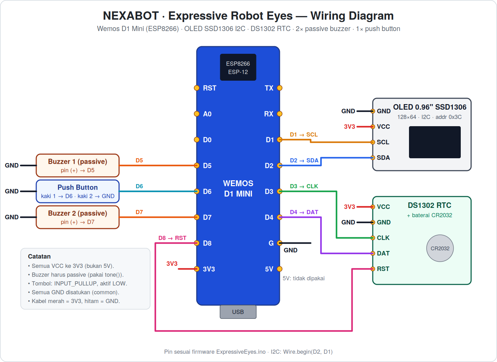

# 🤖 NEXABOT — Expressive Robot Eyes

Robot mata ekspresif berbasis **Wemos D1 Mini (ESP8266)** dengan layar **OLED SSD1306**, efek suara **buzzer**, jam **DS1302** yang tetap jalan walau listrik mati, dan **captive portal** WiFi yang otomatis terbuka saat HP terhubung.



> Versi vektor (tajam saat di-zoom): [`docs/wiring-diagram.svg`](docs/wiring-diagram.svg)

---

## ✨ Fitur

- **16 ekspresi mata** animasi halus: Idle, Happy, Laugh, Thinking, Cool, Sleepy, Love, Wink, Shock, Angry, Sad, Confused, Dizzy, Clown, Bored, dan Stone.
- **Efek suara** untuk tiap ekspresi lewat library `BuzzerFX` (non-blocking, memakai 2 buzzer).
- **Satu tombol**: tekan untuk ganti ekspresi, **tahan ≥ 0,5 detik** untuk menampilkan jam, tanggal, dan bulan.
- **Jam offline (DS1302)**: waktu tetap akurat tanpa koneksi, ditampilkan dalam **WIB (UTC+7)**.
- **Captive portal**: WiFi AP `NEXABOT-AP` menyajikan halaman web (GIF + musik MP3 tertanam di flash). Saat halaman dibuka, waktu HP otomatis disinkronkan ke DS1302.
- **Monitor RAM/Flash** di OLED saat boot (`seeRam`).
- **Mode demo & kontrol Serial** untuk testing.

---

## 🧰 Komponen

| No | Komponen | Jumlah | Keterangan |
|----|----------|:------:|------------|
| 1 | Wemos D1 Mini (ESP8266) | 1 | Mikrokontroler utama |
| 2 | OLED 0.96" SSD1306 128×64 **I2C** | 1 | Alamat I2C `0x3C`, 4 pin (GND, VCC, SCL, SDA) |
| 3 | Modul RTC **DS1302** + baterai CR2032 | 1 | Baterai wajib agar waktu tidak reset |
| 4 | Buzzer **passive** | 2 | Harus *passive* (dibunyikan dengan `tone()`) |
| 5 | Push button (tactile) | 1 | Aktif LOW, memakai `INPUT_PULLUP` internal |
| 6 | Breadboard / PCB lubang + kabel jumper | — | Female-female atau solder langsung |
| 7 | Kabel micro-USB | 1 | Untuk daya dan upload |

---

## 🔌 Tabel Koneksi

Semua modul memakai **3V3** (bukan 5V) dan **GND bersama**.

| Komponen | Pin komponen | Pin Wemos D1 Mini | Fungsi |
|----------|--------------|:-----------------:|--------|
| **OLED SSD1306** | VCC | `3V3` | Daya |
| | GND | `G` | Ground |
| | SCL | `D1` | I2C clock |
| | SDA | `D2` | I2C data |
| **DS1302 RTC** | VCC | `3V3` | Daya |
| | GND | `G` | Ground |
| | CLK | `D3` | Clock |
| | DAT | `D4` | Data (I/O) |
| | RST | `D8` | Reset / CE |
| **Buzzer 1** | (+) | `D5` | Suara |
| | (−) | `G` | Ground |
| **Buzzer 2** | (+) | `D7` | Suara (paralel dengan buzzer 1) |
| | (−) | `G` | Ground |
| **Push button** | Kaki 1 | `D6` | Input (pull-up internal) |
| | Kaki 2 | `G` | Ground |

> 💡 Pin `5V` dan `A0`, `D0`, `RST`, `TX`, `RX` tidak dipakai.

---

## 🛠️ Langkah Pemasangan (Hardware)

1. **Siapkan Wemos D1 Mini.** Solder header pin jika belum terpasang, lalu tancapkan ke breadboard. Biarkan USB belum terhubung selama merakit.
2. **Buat jalur daya.** Hubungkan pin `3V3` Wemos ke rel (+) breadboard, dan pin `G` ke rel (−).
3. **Pasang OLED.** `VCC → 3V3`, `GND → G`, `SCL → D1`, `SDA → D2`.
   Cek urutan pin pada modulmu — sebagian modul OLED memakai urutan `VCC-GND-SCL-SDA`, bukan `GND-VCC-SCL-SDA`.
4. **Pasang DS1302.** Masukkan baterai **CR2032** ke modul, lalu sambungkan `VCC → 3V3`, `GND → G`, `CLK → D3`, `DAT → D4`, `RST → D8`.
5. **Pasang buzzer 1.** Kaki (+) ke `D5`, kaki (−) ke rel GND.
6. **Pasang buzzer 2.** Kaki (+) ke `D7`, kaki (−) ke rel GND.
7. **Pasang tombol.** Satu kaki ke `D6`, kaki lainnya ke rel GND. Tidak perlu resistor eksternal.
8. **Periksa ulang** semua sambungan dengan diagram di atas. Pastikan tidak ada kabel `3V3` yang menyentuh `GND` (cek dengan multimeter mode kontinuitas bila ada).
9. **Colok kabel USB** ke Wemos. Jika OLED menampilkan statistik RAM/Flash lalu animasi mata, rangkaian sudah benar. ✅

---

## 💻 Langkah Pemasangan (Software)

### 1. Arduino IDE & board ESP8266

1. Install [Arduino IDE](https://www.arduino.cc/en/software) (2.x disarankan).
2. Buka **File → Preferences → Additional boards manager URLs**, tambahkan:
   ```
   http://arduino.esp8266.com/stable/package_esp8266com_index.json
   ```
3. Buka **Tools → Board → Boards Manager**, cari **esp8266**, lalu install.

### 2. Library yang dibutuhkan

Install lewat **Tools → Manage Libraries**:

| Library | Pembuat |
|---------|---------|
| Adafruit GFX Library | Adafruit |
| Adafruit SSD1306 | Adafruit |
| **Rtc** (menyediakan `ThreeWire.h` dan `RtcDS1302.h`) | Michael C. Miller (Makuna) |

`ESP8266WiFi`, `ESP8266WebServer`, dan `DNSServer` sudah termasuk di paket board ESP8266.

### 3. Siapkan sketch

Arduino mewajibkan **nama folder sama dengan nama file `.ino`**. Biarkan semua file berada dalam satu folder:

```
ExpressiveEyes/
├── ExpressiveEyes.ino
├── BuzzerFX.h / BuzzerFX.cpp
├── EyeAnimation.h / EyeAnimation.cpp
└── seeRam.h / seeRam.cpp
```

### 4. Pengaturan board & upload

| Pengaturan | Nilai |
|-----------|-------|
| Board | **LOLIN(WEMOS) D1 R2 & mini** |
| Flash Size | 4MB (pilihan FS apa saja) |
| Upload Speed | 921600 (turunkan ke 115200 jika gagal) |
| Port | Port COM / `ttyUSB` Wemos kamu |

Buka `ExpressiveEyes.ino`, klik **Upload**, lalu buka **Serial Monitor** pada baud **115200** untuk melihat log.

---

## 🎮 Cara Pakai

### Tombol

| Aksi | Hasil |
|------|-------|
| **Tekan sebentar** | Ganti ke ekspresi berikutnya (berurutan, lalu kembali ke awal) |
| **Tahan ≥ 0,5 detik** | Tampilkan jam, tanggal, dan bulan selama tombol ditahan |

### Captive portal & sinkronisasi waktu

1. Di HP, sambungkan WiFi ke **`NEXABOT-AP`** (password bawaan: `20092005`).
2. Halaman portal terbuka otomatis. Jika tidak, buka `http://192.168.4.1`.
3. Saat halaman dibuka, HP mengirim waktu ke `/synctime`. Waktu disimpan ke DS1302 dalam **UTC** dan ditampilkan sebagai **WIB**.

> Saat pertama kali dinyalakan (atau baterai RTC habis), jam diisi dari waktu *compile* sebagai nilai awal. Buka portal sekali dari HP untuk mengoreksinya.

### Perintah Serial (115200 baud)

| Kirim | Fungsi |
|-------|--------|
| `a` | Hidupkan / matikan **auto-demo** |
| `0`–`9` | Pilih ekspresi langsung: 0 Idle, 1 Happy, 2 Laugh, 3 Thinking, 4 Cool, 5 Sleepy, 6 Love, 7 Wink, 8 Shock, 9 Angry |

---

## ⚙️ Konfigurasi

Semua ada di `ExpressiveEyes.ino`:

| Yang ingin diubah | Lokasi |
|-------------------|--------|
| Nama & password WiFi AP | `WiFi.softAP("NEXABOT-AP", "20092005");` di `setup()` |
| Pin buzzer & tombol | `#define BUZZER1_PIN`, `BUZZER2_PIN`, `BUTTON_PIN` |
| Pin DS1302 | `ThreeWire myWire(D4, D3, D8);` (DAT, CLK, RST) |
| Pin I2C OLED | `Wire.begin(D2, D1);` (SDA, SCL) |
| Zona waktu | `setenv("TZ", "WIB-7", 1);` |
| Halaman portal | Variabel `index_html`, `gif_data`, dan `audio_data` |

> ⚠️ **Sebelum mempublikasikan repo**, ganti password WiFi bawaan di atas agar tidak tersebar ke publik.

---

## 🩺 Troubleshooting

| Masalah | Penyebab & solusi |
|---------|-------------------|
| OLED kosong, Serial menampilkan `SSD1306 failed!` | Periksa kabel `SDA`/`SCL` (jangan tertukar) dan `VCC`. Coba alamat I2C `0x3D` pada `display.begin(...)` jika modul berbeda. |
| Tidak ada suara | Pastikan buzzer **passive**, bukan *active*. Cek kaki (+) ke `D5` / `D7`. |
| Jam salah atau reset tiap mati listrik | Baterai CR2032 belum terpasang atau habis. Pasang baterai lalu sinkronkan lewat portal. |
| Waktu selisih 7 jam | Waktu belum disinkronkan dari HP. Buka portal `NEXABOT-AP` sekali. |
| Upload gagal atau board bootloop setelah dirakit | `D3`, `D4`, dan `D8` adalah pin *boot strapping* ESP8266. Cabut sementara kabel ke pin tersebut, upload, lalu pasang kembali. |
| Portal tidak terbuka otomatis | Buka `http://192.168.4.1` secara manual, dan matikan data seluler pada HP. |
| Compile error `RtcDS1302.h` tidak ditemukan | Install library **Rtc by Makuna** di Library Manager. |

---

## 📁 Struktur Repo

```
.
├── ExpressiveEyes.ino        # Program utama (WiFi, portal, RTC, tombol, loop)
├── EyeAnimation.h / .cpp     # Mesin animasi mata (state machine, non-blocking)
├── BuzzerFX.h / .cpp         # Pola suara per ekspresi
├── seeRam.h / .cpp           # Monitor RAM/Flash saat boot
├── docs/
│   ├── wiring-diagram.svg
│   └── wiring-diagram.png
└── README.md
```

---

## 🙏 Kredit

- Animasi mata berbasis **FluxGarage RoboEyes**.
- [Adafruit GFX](https://github.com/adafruit/Adafruit-GFX-Library) dan [Adafruit SSD1306](https://github.com/adafruit/Adafruit_SSD1306).
- [Rtc by Makuna](https://github.com/Makuna/Rtc).

> 📌 Cek lisensi library RoboEyes asli sebelum menentukan lisensi untuk repo ini.
